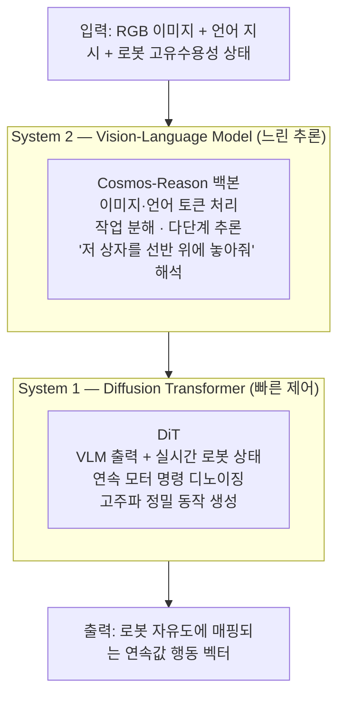
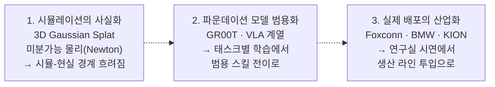

# Chapter 24 — 미래 전망

실행 코드가 없는 **개념·다이어그램** 장이다. 원고의 ASCII 다이어그램을 GitHub 가
네이티브 렌더하는 mermaid 로 정리했다. 사실 관계(GR00T 구조·산업 동향)는
NVIDIA 공개 자료 기준으로 확인했다.

> 검증 성격: 돌릴 코드 없음. 다이어그램의 구조·용어가 원고와 일치하는지,
> 그리고 이 책이 앞에서 다룬 요소(3DGS·Newton·VLA)와 연결되는지를 확인했다.

## b01 — GR00T N1 System 1/2 구조

NVIDIA 의 휴머노이드 파운데이션 모델 GR00T N1 은 **느린 추론(System 2)**과
**빠른 실시간 제어(System 1)**를 분리한 이중 구조다.

| 구성 | 역할 | 주파수 |
|---|---|---|
| System 2 (VLM) | 지시 해석·작업 분해·추론 | 저주파 (느림) |
| System 1 (DiT) | 모터 명령 생성·실시간 제어 | 고주파 (빠름) |

## b02 — 세 가지 산업 동향

## 이 책과의 연결

| 트렌드 | 책에서 다룬 곳 |
|---|---|
| 3D Gaussian Splat | [ch22 gaussian_splat_scene.py](../ch22_vision_learning/gaussian_splat_scene.py) |
| VLA/파운데이션 모델 비전 학습 | [ch22 비전 기반 학습](../ch22_vision_learning/) (교사-학생 증류) |
| Sim-to-Real 배포 | [ch18](../ch18_sim2real/) · [ch19](../ch19_deployment/) |
| 합성 데이터(파운데이션 모델 학습 재료) | [ch17 SDG](../ch17_sdg/) |

GR00T N1 의 System 1/2 용어·구조는 원고 다이어그램과 일치하며, NVIDIA 공개 발표
(GR00T, Cosmos, Newton 물리 엔진)와도 부합한다.
