# 3.11 Isaac Sim 화면 완전 지도 — 버튼마다 무엇을 하는가

> **이 절의 목표**: 화면에 보이는 버튼·패널·메뉴가 각각 무엇을 하는지 전부 짚는 것.
> 3.9절이 "일단 만져 보자"였다면, 이 절은 **옆에 두고 찾아보는 지도**다.

Isaac Sim을 처음 켜면 버튼이 너무 많아 어디부터 손대야 할지 막막하다. 그런데 실제로 자주 쓰는 것은 스무 개 남짓이다. 그 스무 개를 한 번 훑어 두면 나머지는 필요할 때 찾으면 된다.

---

## 3.11.1 화면은 다섯 구역이다

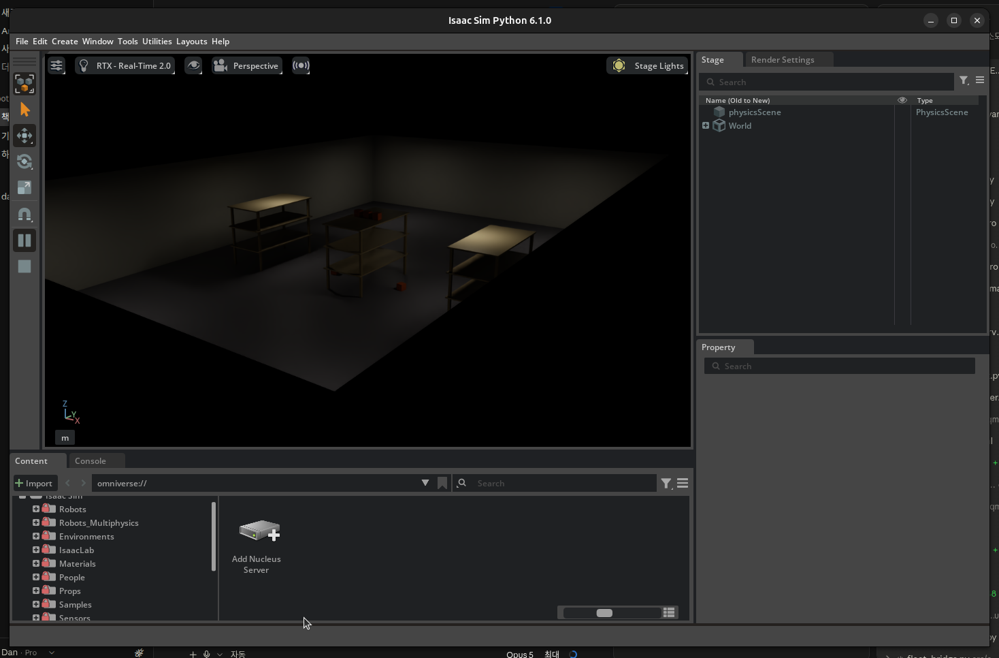
*[그림 3.11-1] Isaac Sim 전체 창 — 다섯 구역으로 나뉜다*

| 구역 | 위치 | 하는 일 |
|---|---|---|
| **메뉴바** | 맨 위 | 만들고(Create) · 창 열고(Window) · 도구 실행(Tools) |
| **툴바** | 왼쪽 세로 | 선택·이동·회전·크기, 그리고 **재생/정지** |
| **뷰포트** | 가운데 | 3D 공간. 위쪽에 렌더러·카메라 전환 바가 붙어 있다 |
| **Stage / Property** | 오른쪽 | 씬에 무엇이 있는지(Stage), 고른 것의 속성(Property) |
| **Content / Console** | 아래 | 에셋 창고(Content), 메시지 창(Console) |

> 💡 **패널이 사라졌다면** `Window` 메뉴에서 다시 켤 수 있다. 배치가 엉켰다면 `Layouts → Default` 로 되돌린다. 이것만 알아도 "화면이 이상해졌다"의 9할은 해결된다.

---

## 3.11.2 메뉴바 — 여덟 개 메뉴

*[그림 3.11-2] 상단 메뉴바*

| 메뉴 | 자주 쓰는 것 |
|---|---|
| **File** | 열기·저장(`Save As`로 USD 저장) |
| **Edit** | 되돌리기, **Preferences**(단위·단축키 설정) |
| **Create** | **Mesh**(도형) · **Light**(조명) · **Physics**(바닥·강체) · **Isaac**(로봇·센서) |
| **Window** | 패널 열기, **Examples → Robotics Examples** |
| **Tools** | **Physics → Physics Inspector**(5.9절), Robotics 도구 |
| **Utilities** | **Common Omnigraphs**(7.9절의 컨트롤러 자동 생성) |
| **Layouts** | 화면 배치 저장·복구 |
| **Help** | 문서·버전 정보 |

📌 이 책에서 가장 자주 쓰는 경로 셋만 외워 두자.
`Create → Physics → Ground Plane` · `Tools → Physics → Physics Inspector` · `Window → Examples → Robotics Examples`

---

## 3.11.3 왼쪽 툴바 — 여덟 개 버튼

위에서 아래로 차례대로다. **단축키를 함께 외우면 마우스를 덜 움직인다.**

| 그림 | 버튼 | 단축키 | 하는 일 |
|---|---|---|---|
| 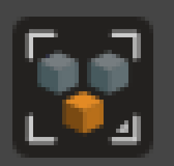 | 선택 모드 | — | 무엇을 고를지 정한다 (전체 / 메시 / 조명 …) |
| 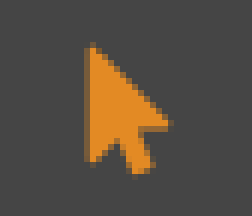 | 선택 | `Q` | 클릭해서 고르기 |
| 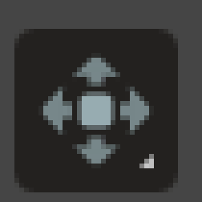 | 이동 | `W` | 화살표를 끌어 위치 옮기기 |
| 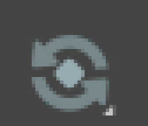 | 회전 | `E` | 고리를 끌어 돌리기 |
| 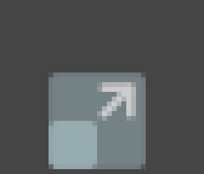 | 크기 | `R` | 크기 바꾸기 |
| 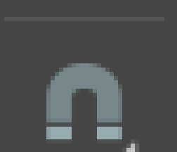 | 스냅 | — | 격자·각도 단위로 딱딱 맞추기 |
| 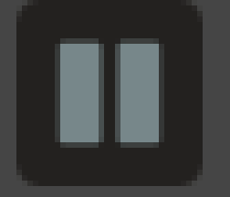 | 재생 / 일시정지 | `Space` | **물리 시뮬레이션 시작·정지** |
| 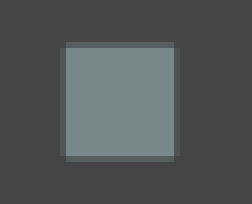 | 정지 | — | 처음 상태로 되돌리기 |

### 재생과 정지는 다르다

> ⚠️ **일시정지(Pause)는 멈출 뿐, 정지(Stop)는 되돌린다.**
> Pause 후 Play 하면 멈춘 자리에서 이어진다. Stop 을 누르면 모든 물체가 **시작 위치로 복귀**한다.
> 실습 중 "로봇이 원래 자리로 돌아가 버렸다"면 Stop 을 누른 것이다.

### 스냅이 쓸모 있는 순간

> 💡 선반 위에 상자를 정확히 올리거나, 로봇을 격자에 맞춰 배치할 때 스냅을 켜면 손떨림이 사라진다. 꺼 두면 0.001 m 단위로 어긋나 "분명 올렸는데 떠 있다"가 된다.

---

## 3.11.4 뷰포트 상단 바 — 여섯 개 버튼

뷰포트 위에 가로로 붙어 있는 바다. **보이는 방식**을 바꾸는 것들이라 씬 자체는 변하지 않는다.

| 그림 | 버튼 | 하는 일 |
|---|---|---|
| 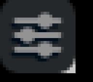 | 뷰포트 설정 | 해상도·화각 등 |
| 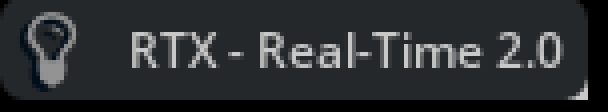 | **렌더러** | `RTX - Real-Time`(작업용, 빠름) ↔ `RTX - Interactive`(최종 확인용, 느리지만 사실적) |
| 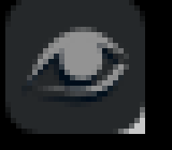 | 표시 항목 | 격자·축·조명 아이콘·카메라를 보이거나 숨긴다 |
| 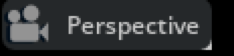 | 카메라 | Perspective ↔ Top/Front/Right, 또는 **내가 만든 카메라**로 전환 |
| 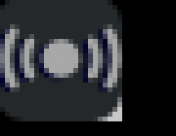 | HUD | FPS·해상도 같은 정보를 화면에 겹쳐 표시 |
| 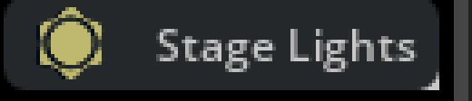 | Stage Lights | 기본 조명 프리셋 전환 |

### 화면이 새까맣다면

> ⚠️ 조명을 안 넣었거나 끈 것이다. **Stage Lights** 를 켜거나 프리셋(`Gray Studio` 등)을 고르면 바로 보인다.
> 4.5절에서 다루듯 조명은 SDG 데이터 품질에도 직결되므로, 작업 중에는 켜 두고 확인하자.

### 카메라 전환이 중요한 이유

로봇에 카메라를 달면(6.2절) 이 메뉴에 그 카메라가 나타난다. **로봇이 보는 화면**으로 바로 전환해 확인할 수 있다. 7.9절에서 JetBot을 조종할 때 특히 요긴하다.

---

## 3.11.5 Stage 패널 — 씬의 목차

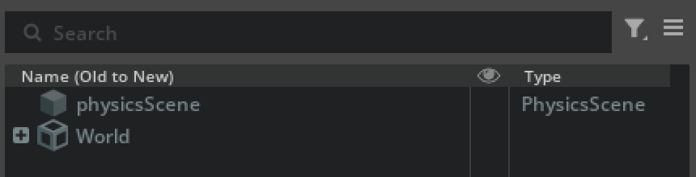
*[그림 3.11-3] Stage 트리 — 씬에 있는 모든 것이 여기 나온다*

씬에 넣은 모든 것이 트리로 쌓인다. 로봇 하나를 넣으면 그 아래에 링크·조인트·메시가 줄줄이 달린다.

| 할 수 있는 일 | 방법 |
|---|---|
| 고르기 | 이름 클릭 (뷰포트에서 선택된다) |
| 숨기기 | 눈 아이콘 클릭 |
| 이름 바꾸기 | 더블클릭 |
| 묶기 | 여러 개 선택 → 우클릭 → `Group` |
| 지우기 | 선택 → `Delete` |
| 빈 그룹 만들기 | 우클릭 → `Create → Xform` |

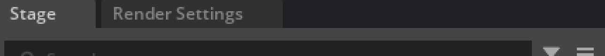
*[그림 3.11-4] Stage 패널의 탭 — Layer·Render Settings 등이 같이 있다*

> 💡 **Xform 은 빈 상자다.** 로봇·센서·조명을 하나의 Xform 아래 묶어 두면 통째로 옮기고 숨길 수 있다. 씬이 복잡해질수록 이 습관이 시간을 아껴 준다.

---

## 3.11.6 Property 패널 — 고른 것의 속성

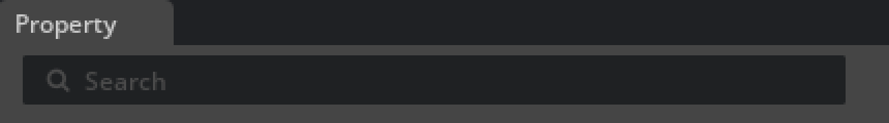
*[그림 3.11-5] Property 패널 — Transform, Material, Physics*

Stage 에서 무언가를 고르면 이 패널이 채워진다.

| 묶음 | 내용 |
|---|---|
| **Transform** | Translate(위치) · Orient(회전) · Scale(크기) |
| **Material** | 색·재질 연결 |
| **Physics** | 질량·마찰·충돌체 |
| **Raw USD Properties** | 위 항목의 원본 USD 속성 전부 |

### + Add 버튼이 핵심이다

패널 아래쪽 **`+ Add`** 로 기능을 얹는다. 3.9절에서 큐브를 떨어뜨릴 때 쓴 것이 이것이다.

| 고르는 항목 | 결과 |
|---|---|
| `Physics → Rigid Body with Colliders Apply` | 중력을 받고 부딪히는 물체가 된다 |
| `Physics → Colliders Apply` | 안 움직이지만 부딪히기는 한다 (벽·바닥) |
| `Physics → Articulation Root` | 관절 로봇의 뿌리로 지정 |

> ⚠️ **22.6절에서 겪은 함정**: 장애물에 충돌체(Collider)를 안 주면 LiDAR 광선이 그냥 통과한다. 눈에 보인다고 센서에도 보이는 것이 아니다.

---

## 3.11.7 Content 브라우저 — 에셋 창고

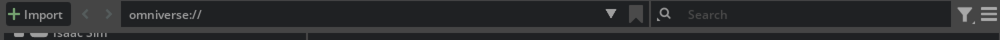
*[그림 3.11-6] Content 브라우저 — 경로를 따라 에셋을 찾는다*

NVIDIA가 제공하는 자산이 폴더로 정리되어 있다. **직접 모델링할 필요가 없다**는 것이 Isaac Sim의 가장 큰 장점 중 하나다.

| 폴더 | 들어 있는 것 |
|---|---|
| `Robots` | Franka · Spot · Go2 · H1 · Nova Carter · JetBot … |
| `Robots_Multiphysics` | 물리 설정이 더 정교한 로봇 |
| `Environments` | 창고 · 사무실 · 병원 · 격자 바닥 |
| `Props` | 상자 · 팰릿 · 공구 · 식품 — 파지 연습용 |
| `Materials` | 금속 · 플라스틱 · 바닥재 |
| `People` | 사람 캐릭터 (12.4절 사람 시뮬레이션) |
| `Sensors` | RealSense · Ouster · SICK · RPLIDAR … |
| `Samples` | 예제 씬 |
| `IsaacLab` | Isaac Lab 학습용 자산 |

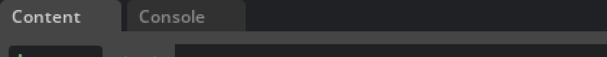
*[그림 3.11-7] Content 브라우저 탭 구성*

### 쓰는 법은 둘뿐이다

1. **더블클릭** — 그 USD 를 현재 Stage 에 **연다**(환경처럼 통째로 쓸 때)
2. **드래그 & 드롭** — 뷰포트로 끌어다 놓으면 **현재 씬에 추가**된다(로봇·소품)

> 💡 USD 파일 위에 마우스를 올리면 **썸네일 미리보기**가 뜬다. 이름만으로 구분이 안 되는 환경·소품을 고를 때 유용하다.

---

## 3.11.8 내장 예제 — 코드 한 줄 없이 로봇 움직이기

`Window → Examples → Robotics Examples` 를 켜면 **로봇 + 환경 + 학습된 정책**이 한 묶음으로 들어 있는 예제가 나온다. **Load 를 누르고 Play 만 하면** 로봇이 움직인다.

| 예제 | 무엇을 보나 | 조작 |
|---|---|---|
| **Quadruped** | Spot·ANYmal 4족 보행 | **방향키**로 걷게 한다 |
| **Humanoid** | H1 휴머노이드 보행 | 방향키 |
| **UR10 Palletizing** | 산업용 팔이 상자를 팰릿에 쌓는다 | `Start Palletizing` 버튼 |
| **Franka Stacking** | 블록 집어 쌓기 | 자동 |

이 정책들은 **Isaac Lab 에서 학습된 결과물**이다. Chapter 15~16에서 직접 학습시키게 되는데, 그 전에 "학습이 끝나면 이렇게 움직인다"를 눈으로 봐 두면 목표가 분명해진다.

> 📌 예제가 돌아가는 동안 **Stage 패널에서 로봇을 펼쳐 보자.** 관절·센서·OmniGraph 가 어떻게 구성되어 있는지가 그대로 드러난다. 남이 만든 완성품을 뜯어보는 것이 가장 빠른 학습법이다.

---

## 3.11.9 자주 쓰는 조작 모음

### 카메라

| 동작 | 조작 |
|---|---|
| 둘러보기(궤도) | `Alt` + 좌클릭 드래그 |
| 평행 이동 | 중간 버튼 드래그 |
| 확대·축소 | 휠 |
| 자유 비행 | 우클릭 + `W/A/S/D`, `Q`(아래) `E`(위) |
| 비행 속도 | 우클릭 유지 + 휠 |
| 선택한 것으로 이동 | `F` |

### 알아 두면 덜 헤매는 것들

> 📌 **바닥(Ground Plane)은 무한하다.** 뷰포트에는 네모난 판으로 보이지만 실제로는 끝없이 펼쳐져 있다. 물체를 판 바깥으로 옮겨도 떨어지지 않는다.

> ⚠️ **Play 중에는 Stage 편집이 제한된다.** 물체를 추가하거나 옮기려면 Stop 을 먼저 누른다.

> 💡 **단위는 미터다.** 뷰포트 왼쪽 아래 `m` 표시로 확인할 수 있다. CAD에서 밀리미터로 만든 모델을 가져오면 1000배 크게 들어오니 5.2절의 변환 설정을 확인하자.

---

## 3.11.10 실습 과제 — 난이도별 다섯 가지

> 🛠️ **실습**: 쉬운 것부터 차례로 해 보자. 전부 코드 없이 GUI만으로 된다.

### 과제 1 ⭐ — 색 바꾸기 (3분)

1. `Create → Mesh → Cube`
2. `Create → Material → OmniPBR`
3. Cube 선택 → Property → Material 에서 방금 만든 재질 연결
4. 재질 선택 → `Albedo Color` 를 원하는 색으로

**확인**: 뷰포트의 큐브 색이 바뀌는가?

### 과제 2 ⭐⭐ — 도미노 (10분)

1. `Create → Physics → Ground Plane`
2. 얇은 상자(Cube 에 Scale 적용)를 만들고 `+ Add → Physics → Rigid Body with Colliders`
3. `Ctrl+C / Ctrl+V` 로 복제해 일정 간격으로 세운다 (**스냅을 켜면 쉽다**)
4. 맨 앞 하나를 살짝 기울인다
5. ▶️ Play

**확인**: 차례로 넘어지는가? 안 넘어지면 간격이 너무 넓거나 상자가 너무 두껍다.

### 과제 3 ⭐⭐ — 로봇 전시장 (10분)

1. `Environments/Simple_Warehouse/warehouse.usd` 더블클릭
2. `Robots` 에서 **서로 다른 로봇 4종**을 드래그 & 드롭
3. 이동 도구로 한 줄로 세운다
4. 카메라를 정면으로 맞추고 `F` 로 프레이밍
5. ▶️ Play 로 각 로봇의 반응을 관찰

**확인**: 어떤 로봇이 서 있고 어떤 로봇이 주저앉는가? 그 차이는 3.9.4절에서 설명한 **에셋의 드라이브 게인** 때문이다.

### 과제 4 ⭐⭐⭐ — 로봇 시점 보기 (15분)

1. 아무 로봇이나 씬에 놓는다
2. `Create → Camera`
3. Stage 에서 카메라를 **로봇의 몸체(chassis/base_link) 아래로 끌어다 놓는다**
4. Property → Transform 으로 위치·각도를 조정
5. 뷰포트 상단 바의 **카메라 메뉴**에서 방금 만든 카메라를 고른다
6. ▶️ Play

**확인**: 로봇이 움직일 때 화면도 같이 움직이는가?

> ⚠️ 카메라를 로봇 **루트**가 아니라 실제로 움직이는 **몸체 링크** 아래에 넣어야 따라간다. 22.6절에서 똑같은 함정을 다뤘다.

### 과제 5 ⭐⭐⭐ — 내장 예제 뜯어보기 (20분)

1. `Window → Examples → Robotics Examples` → **Quadruped** → `Load`
2. ▶️ Play 후 방향키로 걸려 본다
3. **Stop** 을 누르고 Stage 패널에서 로봇을 펼친다
4. 관절을 하나 골라 Property 에서 `stiffness`·`damping` 을 확인한다
5. `Tools → Physics → Physics Inspector` 로 관절을 직접 돌려 본다 (5.9절)

**확인**: 관절이 몇 개인가? 게인은 얼마인가? 이 값들이 Chapter 16 에서 직접 학습시킬 때의 출발점이 된다.

---

## 이 절에서 배운 것

| 항목 | 핵심 |
|---|---|
| 화면 구성 | 메뉴바 · 툴바 · 뷰포트 · Stage/Property · Content 다섯 구역 |
| 툴바 단축키 | `Q` 선택 · `W` 이동 · `E` 회전 · `R` 크기 · `Space` 재생 |
| Pause vs Stop | Pause 는 멈춤, **Stop 은 시작 위치로 복귀** |
| 렌더러 | 작업은 Real-Time, 최종 확인은 Interactive |
| Stage 패널 | 씬의 목차. Xform 으로 묶어 관리한다 |
| Property `+ Add` | 물체에 물리·관절을 얹는 입구 |
| Content 브라우저 | 더블클릭 = 열기, 드래그 = 추가 |
| 내장 예제 | 학습된 정책을 Load → Play 만으로 체험 |
| 바닥은 무한하다 | 판 바깥으로 나가도 떨어지지 않는다 |

화면을 알았으니 이제 코드로 넘어갈 차례다. Chapter 4 에서는 여기서 손으로 한 일을 **Python 으로 재현**한다. GUI에서 클릭 다섯 번이면 되는 일을 왜 코드로 쓰는지는, 같은 씬을 100개 만들어야 할 때 바로 알게 된다.
