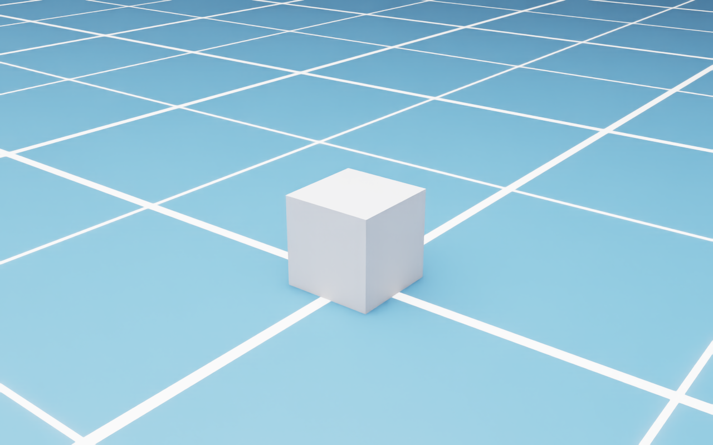
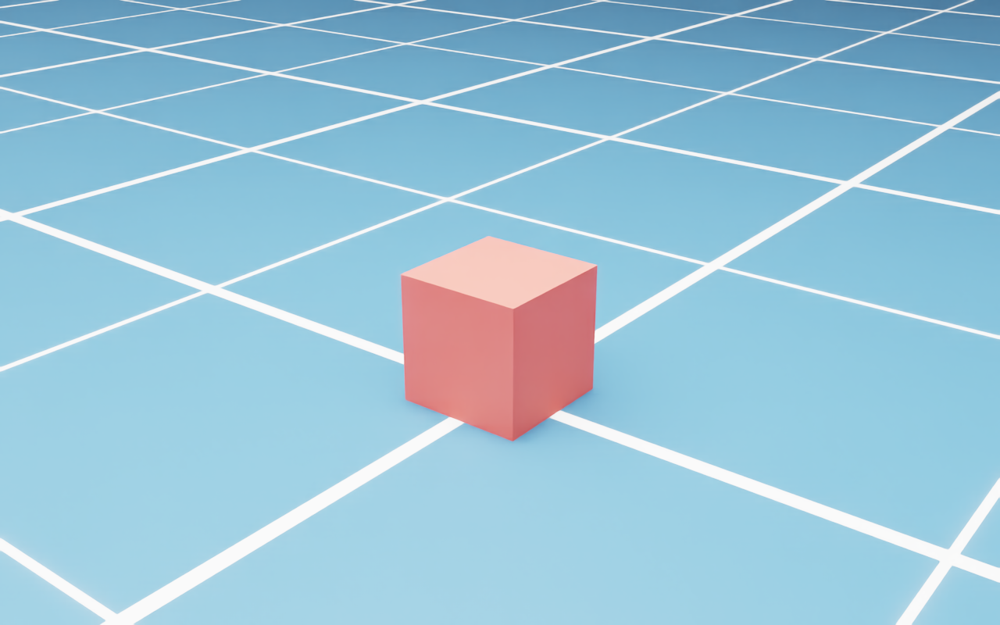
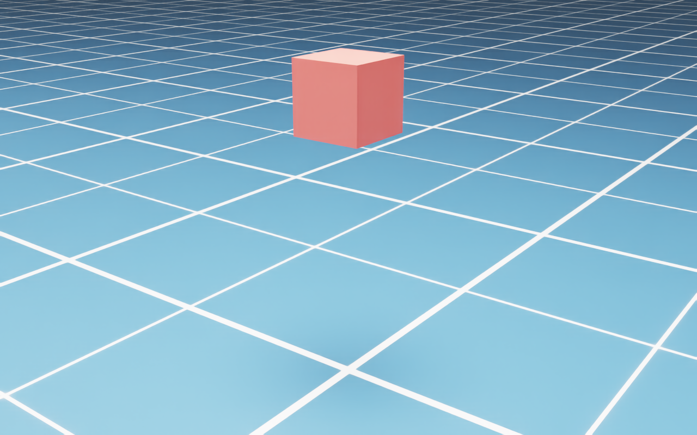
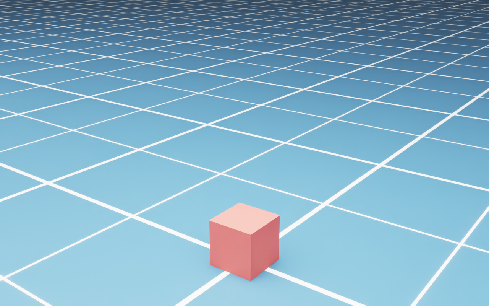
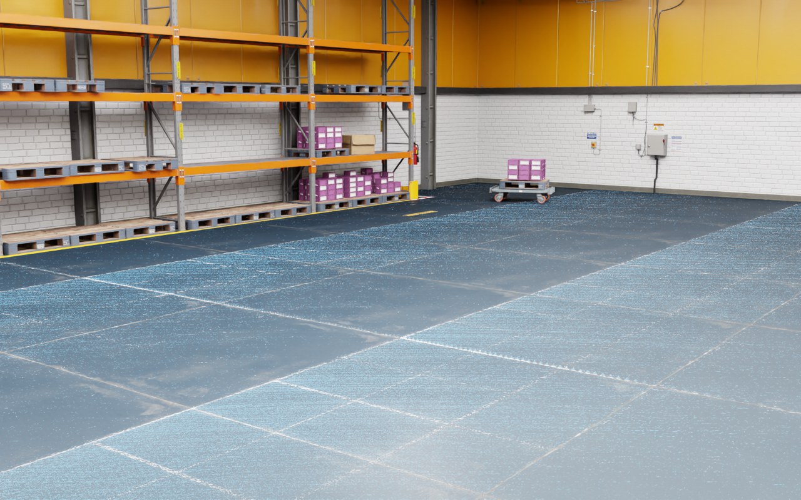
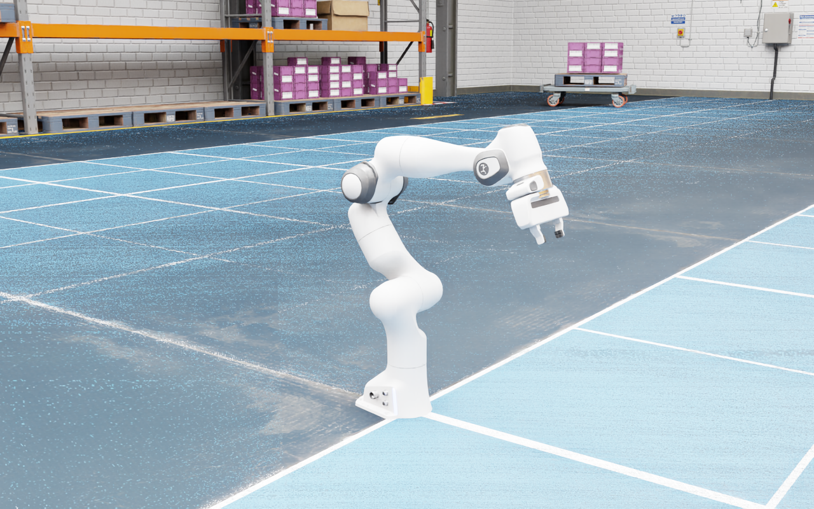
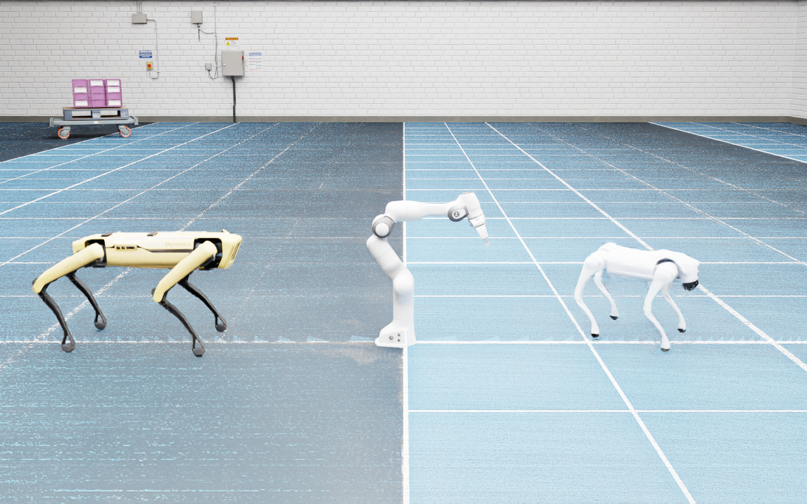
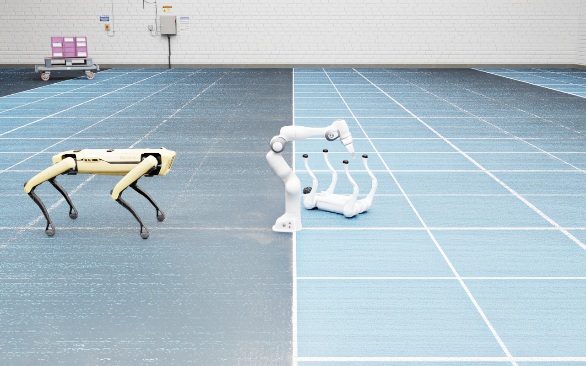
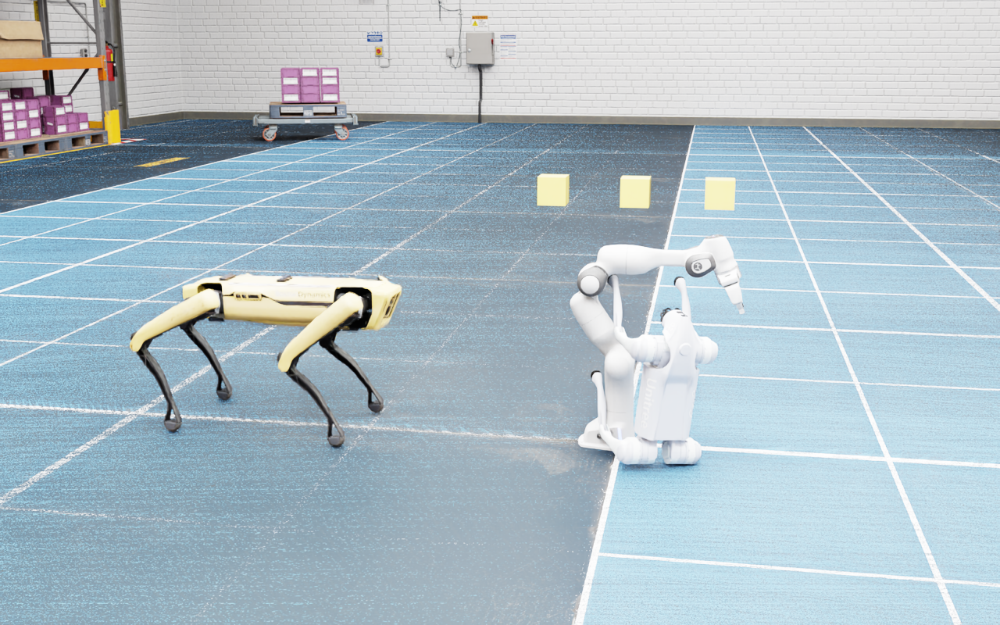
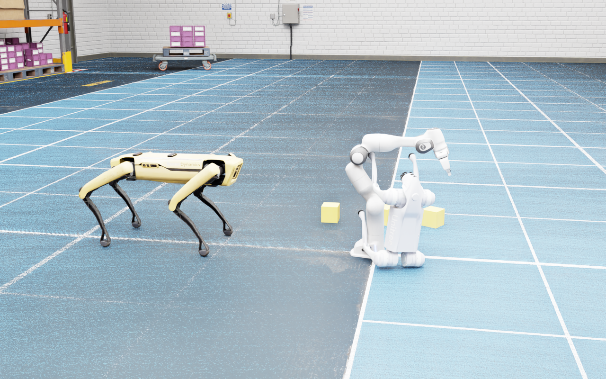

# 3.9 첫 만남 — GUI로 놀아보기

> **이 절의 목표**: 코드 한 줄 없이 Isaac Sim GUI만으로 로봇을 배치하고, 물리 시뮬레이션을 돌려 보는 것.
> 설치 직후 가장 먼저 해야 할 일은 "이게 돌아가는지 확인"이 아니라 **"이걸로 뭘 할 수 있는지 감 잡기"**다.

---

## 3.9.1 GUI 기본 조작

Isaac Sim을 실행하면 중앙에 빈 뷰포트가 나타난다. 3D 공간을 자유롭게 탐색하는 법부터 익히자.

### 카메라 네비게이션

| 동작 | 키 / 마우스 | 설명 |
|---|---|---|
| 궤도(Orbit) | Alt + 마우스 좌 드래그 | 관심점을 중심으로 카메라가 회전 |
| 팬(Pan) | 마우스 중 드래그 | 카메라를 수평·수직 이동 |
| 줌(Zoom) | 마우스 휠 | 확대·축소 |
| 비행(Fly) | 우클릭 + W/A/S/D/Q/E | FPS 게임처럼 자유 비행 |
| 포커스(Focus) | F | 선택한 오브젝트에 카메라 맞추기 |
| 이동 속도 | 우클릭 + 휠 | Fly 모드 속도 조절 |

💡 **팁**: 처음에는 Fly 모드(우클릭 + WASDQE)가 가장 직관적이다. 게임 경험이 있다면 바로 익숙해질 것이다.

### 뷰포트 기본 설정

뷰포트 상단 바에서 유용한 옵션을 확인하자:

- **Renderer**: RTX – Real-Time(기본) vs RTX – Interactive(Path Tracing). 작업 중에는 Real-Time, 최종 확인은 Path Tracing이 좋다.
- **Show By Type**: 그리드, 축, 라이트 아이콘 표시/숨김을 전환한다.
- **Camera**: Perspective(기본) / Top / Front / Right 등 정사영 뷰를 선택한다.
- **HUD**: 뷰포트의 FPS, 해상도, 카메라 정보 등 오버레이 표시를 켜고 끈다.

---

## 3.9.2 오브젝트 만들어 보기

### Create 메뉴로 기본 도형 추가

상단 메뉴에서 **Create → Mesh**를 열면 기본 도형을 만들 수 있다.

1. **Create → Mesh → Cube** — 큐브 하나가 씬 중앙에 나타난다.
2. Stage 패널(왼쪽 아래)에서 방금 만든 Cube를 선택한다.
3. Property 패널(오른쪽)에서 **Transform**을 확인한다:
   - **Translate**: 위치 (X, Y, Z)
   - **Orient**: 회전 (쿼터니언 또는 오일러)
   - **Scale**: 크기

직접 숫자를 바꿔 보자. X에 100을 넣으면 큐브가 옆으로 이동한다.

*[그림 3.9-1] Create → Mesh → Cube — 씬 중앙에 큐브가 생긴다*

### 재질(Material) 입히기

밋밋한 회색 큐브에 색을 입혀 보자:

1. **Create → Material → OmniPBR** — 새 재질이 생성된다.
2. Property 패널에서 **Albedo Color**를 원하는 색으로 변경한다.
3. Stage 패널에서 Cube를 선택한 뒤 Property의 **Material** 섹션에서 방금 만든 재질을 **Bind**한다.

*[그림 3.9-2] Albedo Color를 빨강으로 바꾸고 큐브에 바인딩한 결과*

### 물리 부여

큐브에 물리를 입혀서 중력에 떨어지게 만들어 보자:

1. Stage에서 Cube를 선택한다.
2. Property 패널 하단 **+ Add** → **Physics** → **Rigid Body with Colliders Apply**를 클릭한다.
3. 아직 바닥이 없으니, **Create → Physics → Ground Plane**으로 바닥을 추가한다.
4. 뷰포트 왼쪽의 ▶️(Play) 버튼을 누른다.

*[그림 3.9-3] Rigid Body를 적용하고 큐브를 공중(z = 1.2 m)에 올린 상태 — Play 전*

*[그림 3.9-4] Play 후 — 큐브가 바닥에 착지했다 (최종 z = 0.15 m = 한 변 0.3 m의 절반)*

큐브가 바닥으로 떨어지고 착지하면 성공이다. ⏹️(Stop)으로 시뮬레이션을 멈추면 원래 위치로 돌아간다.

💡 **확인 요령**: 착지한 큐브의 Translate Z 값이 **큐브 한 변의 절반**과 같으면 물리가 정확히 동작한 것이다.
한 변이 0.3 m인 큐브라면 Z = 0.15 m가 된다.

⚠️ **주의**: Play 중에는 Stage 편집이 제한된다. Stop을 누른 뒤 편집하자.

---

## 3.9.3 내장 환경 로딩하기

Isaac Sim은 다양한 내장 환경(Warehouse, Office, Hospital 등)을 제공한다. 직접 씬을 만들 필요 없이 바로 사용할 수 있다.

### Content Browser에서 환경 불러오기

1. 하단 **Content** 패널을 연다 (없으면 **Window → Browsers → Content** 메뉴).
2. 왼쪽 경로에서 `omniverse://localhost/NVIDIA/Assets/Isaac/` 으로 이동한다.
3. `Environments/` 폴더 안에서 원하는 환경을 찾는다:
   - `Simple_Warehouse/warehouse.usd` — 물류 창고
   - `Hospital/hospital.usd` — 병원 내부
   - `Office/office.usd` — 사무실
4. 파일을 **더블클릭**하면 현재 Stage에 로드된다.

*[그림 3.9-5] `Simple_Warehouse/warehouse.usd`를 로드한 화면 — 선반·바닥·조명이 모두 포함되어 있다*

💡 **팁**: USD 파일 위에 마우스를 올리면 썸네일 미리보기가 나타난다. 환경을 고를 때 유용하다.

---

## 3.9.4 로봇 드래그 & 드롭 배치

이제 진짜 로봇을 씬에 올려 보자. Content Browser에서 로봇을 **드래그해서 뷰포트에 놓으면** 된다.

### 내장 로봇 찾기

Content Browser에서 `NVIDIA/Assets/Isaac/Robots/` 아래를 탐색한다:

| 경로 | 로봇 | 종류 |
|---|---|---|
| `FrankaRobotics/FrankaPanda/franka.usd` | Franka Panda | 7축 매니퓰레이터 |
| `BDX/Spot/spot.usd` | Boston Dynamics Spot | 4족 보행 |
| `Unitree/Go2/configuration/go2_description_physics.usd` | Unitree Go2 | 4족 보행 |
| `Unitree/H1/h1_minimal.usd` | Unitree H1 | 휴머노이드 |
| `NVIDIA/NovaCarter/nova_carter.usd` | Nova Carter | AMR (자율주행) |

### 배치 방법

1. Content Browser에서 로봇 USD 파일을 찾는다.
2. 파일을 **마우스 좌클릭으로 드래그**해서 뷰포트에 **드롭**한다.
3. 로봇이 씬에 나타난다. 이동 기즈모(Move Gizmo)로 위치를 조정한다.

*[그림 3.9-6] Franka Panda를 창고 바닥에 드롭한 직후*

여러 로봇을 함께 배치할 수도 있다. Franka를 가운데, Spot을 왼쪽, Go2를 오른쪽에 놓아 보자.

*[그림 3.9-7] Spot(왼쪽) · Franka(가운데) · Go2(오른쪽) 3종 배치 완료 — Play 전*

### 시뮬레이션 실행

▶️(Play)를 누르면 로봇마다 결과가 다르다.

*[그림 3.9-8] Play 후 — Go2(오른쪽)는 주저앉고, Spot(왼쪽)은 그대로 서 있다*

| 로봇 | Play 후 몸통 높이 | 결과 |
|---|---|---|
| **Franka** | 베이스 0.00 m 고정 | 베이스는 바닥에 고정, 팔만 중력으로 처진다 |
| **Spot** | 0.51 m (유지) | **서 있다** — USD 에셋에 관절 드라이브가 설정되어 있다 |
| **Go2** | 0.06 m | 주저앉는다 — 관절 드라이브 게인이 0이다 |

⚠️ **왜 Spot만 서 있을까?** "토크가 없으면 무조건 쓰러진다"는 흔한 오해다.
실제로는 **USD 에셋에 저장된 관절 드라이브(stiffness/damping) 설정**이 결정한다.
Spot의 `spot.usd`는 드라이브 게인이 들어 있어 기본 자세를 유지하고,
Go2의 `go2_description_physics.usd`는 게인이 0이라 중력에 무너진다.

📌 **NOTE**: 로봇이 쓰러지는 것을 보고 "뭔가 잘못됐다"고 생각하기 쉽다. 하지만 드라이브 게인이 0이면
중력만 작용하므로 **쓰러지는 것이 물리적으로 정확한 결과**다. 로봇을 원하는 자세로 **서 있게** 하려면
관절 컨트롤러로 게인과 목표 각도를 직접 주어야 하고, 이는 뒤 장(Ch5, Ch7)에서 다룬다.

---

## 3.9.5 내장 예제(Robotics Examples) 체험

Isaac Sim은 사전 구성된 예제를 제공한다. 이 예제들은 로봇 + 환경 + 컨트롤러가 모두 포함되어 있어 **Play만 누르면** 로봇이 동작한다.

### 예제 실행 방법

1. 상단 메뉴에서 **Isaac Examples** 를 연다.
2. 카테고리를 선택한다:
   - **Quadruped** — 4족 보행 로봇이 걸어 다닌다
   - **Humanoid** — 휴머노이드가 걸어 다닌다
   - **Manipulation** — Franka가 물체를 집는다
3. **Load** 버튼을 누르면 예제 씬이 로드된다.
4. ▶️(Play)를 누르면 로봇이 미리 프로그래밍된 동작을 수행한다.

💡 **팁**: 예제가 돌아가는 동안 Stage 패널에서 각 prim을 클릭해 보자. 로봇의 관절, 센서, 컨트롤러가 어떻게 구성되어 있는지 감을 잡을 수 있다.

### 추천 예제 순서

| 순서 | 예제 | 왜 먼저? |
|---|---|---|
| 1 | Franka — Simple Stacking | 가장 단순한 매니퓰레이션 |
| 2 | Quadruped — A1/Go2 | 4족 보행의 시각적 임팩트 |
| 3 | Humanoid — H1 | 복잡한 다자유도 제어 |
| 4 | Navigation — Carter | AMR 자율주행 (Nav2 연동) |

---

## 3.9.6 실습 과제 — 5분 챌린지

> 🛠️ **실습**: 아래 조건의 씬을 **5분 안에** 만들어 보자.

**조건**:
1. Warehouse 환경을 로드한다.
2. Franka Panda 1대를 창고 중앙 테이블 위에 배치한다.
3. Spot 1대를 바닥에 배치한다.
4. 기본 큐브 3개를 Franka 앞에 놓고, 물리(Rigid Body)를 부여한다.
5. ▶️(Play)를 눌러 큐브가 떨어지는 것과, 로봇마다 자세 유지 여부가 다른 것을 확인한다.

*[그림 3.9-9] 5분 챌린지 — Warehouse + Spot + Franka + 큐브 3개 배치 완료 (Play 전)*

*[그림 3.9-10] Play 후 — 큐브 3개가 바닥에 떨어지고(z = 0.06 m), Franka의 팔이 처졌다*

**체크리스트**:
- [ ] Warehouse 환경이 보이는가?
- [ ] Franka가 테이블 위에 있는가?
- [ ] Spot이 바닥에 있는가?
- [ ] 큐브 3개에 물리가 적용되어 떨어지는가? (최종 Z = 한 변의 절반)
- [ ] Play/Stop으로 시뮬레이션을 제어할 수 있는가?

완성된 씬을 **File → Save As**로 `my_first_scene.usd`로 저장하면 이 절의 실습이 완료된다.

---

## 이 절에서 배운 것

| 항목 | 핵심 |
|---|---|
| 카메라 조작 | 우클릭 + WASDQE (Fly), Alt + 좌드래그 (Orbit) |
| 오브젝트 생성 | Create → Mesh, Create → Physics → Ground Plane |
| 물리 부여 | Property → + Add → Physics → Rigid Body |
| 로봇 배치 | Content Browser에서 드래그 & 드롭 |
| 시뮬레이션 | ▶️ Play / ⏹️ Stop |
| 로봇이 쓰러지는 이유 | 토크가 아니라 **USD 에셋의 드라이브 게인**이 결정한다 |
| 환경 로딩 | Content Browser → Environments → USD 더블클릭 |

다음 장(Ch4)에서는 이 GUI 조작을 **Python 코드**로 자동화하는 법을 배운다. GUI에서 손으로 한 일을 코드 한 줄로 재현할 수 있다는 것이 Isaac Sim 자동화의 출발점이다.
