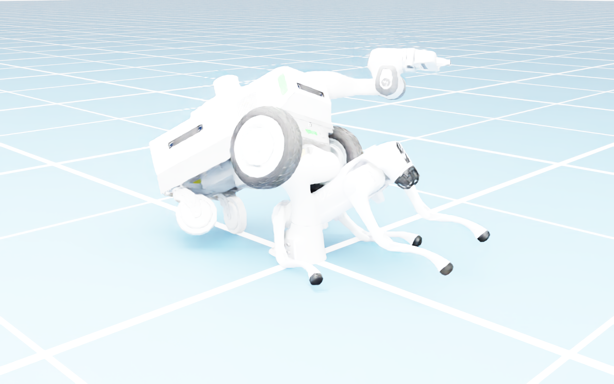
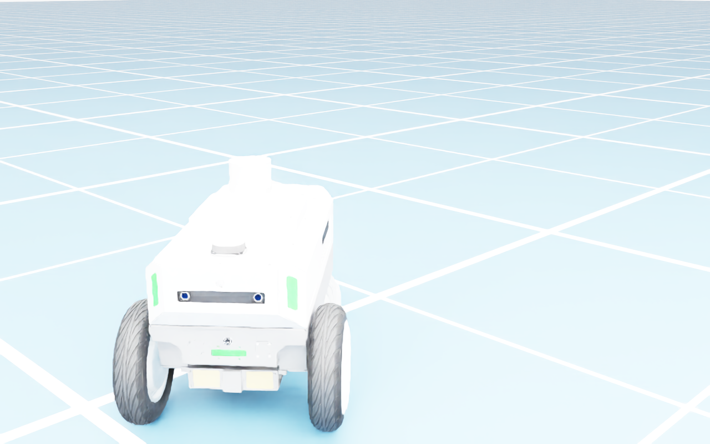

# 7.9 OmniGraph 비주얼 프로그래밍

> **이 절의 목표**: 코드를 작성하지 않고 OmniGraph의 노드 기반 에디터로 로봇을 제어하는 것.
> 키보드 입력을 받아 로봇을 움직이는 Action Graph를 직접 만들어 보고, Python 스크립트 노드로 확장하는 방법까지 다룬다.

---

## 7.9.1 OmniGraph란?

OmniGraph는 Isaac Sim의 **노드 기반 비주얼 프로그래밍** 시스템이다. 코드를 작성하는 대신 **노드**(기능 블록)를 화면에 배치하고 **연결선**(와이어)으로 데이터 흐름을 정의한다.

### 왜 OmniGraph를 쓰는가?

| 방식 | 장점 | 단점 |
|---|---|---|
| Python 스크립트 | 완전한 자유도, 디버깅 용이 | 매 프레임 콜백을 직접 관리 |
| OmniGraph | 시각적 흐름, ROS 2 연동 내장, 실시간 수정 | 복잡한 로직에는 불편 |

Isaac Sim의 **ROS 2 브리지**(Ch8)는 내부적으로 OmniGraph로 구현되어 있다. ROS 2 토픽 발행/구독, 센서 데이터 전달, 로봇 제어 명령 수신이 모두 OmniGraph 노드다. 따라서 ROS 2를 쓰려면 OmniGraph의 기본 개념을 알아야 한다.

### OmniGraph의 종류

| 종류 | 용도 |
|---|---|
| **Action Graph** | 이벤트 기반 실행 (키보드 입력, 시뮬 시작 등) |
| **Push Graph** | 매 프레임 자동 실행 (센서 데이터 스트리밍) |
| **Lazy Graph** | 요청 시에만 실행 |

이 절에서는 가장 많이 쓰는 **Action Graph**를 다룬다.

---

## 7.9.2 첫 번째 Action Graph — 키보드로 로봇 제어

이동 로봇(Differential Drive)을 키보드 W/A/S/D로 조종하는 OmniGraph를 만들어 보자.

### 준비: 로봇 로딩

1. Content Browser에서 Nova Carter를 씬에 드래그한다:
   `NVIDIA/Assets/Isaac/Robots/NVIDIA/NovaCarter/nova_carter.usd`
2. **Create → Physics → Ground Plane**으로 바닥을 추가한다.


*[그림 7.9-1] Nova Carter를 바닥에 배치한 상태 — Play 전*

### Action Graph 생성 (GUI)

1. 상단 메뉴에서 **Window → Visual Scripting → Action Graph**를 선택한다.
2. Action Graph 에디터가 열린다. 빈 캔버스가 보인다.
3. 왼쪽의 **노드 검색창**에서 노드를 찾아 캔버스에 드래그한다.

### 필요한 노드

다음 순서로 노드를 추가하고 연결한다:

```
[On Playback Tick] ──▶ [Differential Controller] ──▶ [Articulation Controller]
                              ▲
[On Keyboard Input] ──────────┘
```

| 노드 | 검색어 | 역할 |
|---|---|---|
| **On Playback Tick** | `playback tick` | 매 시뮬레이션 프레임마다 실행 |
| **On Keyboard Input** | `keyboard` | 키보드 키가 눌렸을 때 이벤트 발생 |
| **Differential Controller** | `differential` | 선속도/각속도 → 좌우 바퀴 속도 변환 |
| **Articulation Controller** | `articulation` | 관절에 명령을 전달 |

### 노드 연결 절차

**1단계 — On Playback Tick → Differential Controller**

On Playback Tick의 **Tick** 출력을 Differential Controller의 **Exec In** 입력에 연결한다. 이렇게 하면 매 프레임 Differential Controller가 실행된다.

**2단계 — On Keyboard Input 설정**

On Keyboard Input 노드를 4개 추가한다 (W, A, S, D 각각):

| 노드 | Key | 출력 값 |
|---|---|---|
| On Keyboard Input (W) | W | 전진: linearVelocity = 0.5 |
| On Keyboard Input (S) | S | 후진: linearVelocity = -0.5 |
| On Keyboard Input (A) | A | 좌회전: angularVelocity = 0.5 |
| On Keyboard Input (D) | D | 우회전: angularVelocity = -0.5 |

**3단계 — Differential Controller 설정**

Property 패널에서 Differential Controller의 속성을 설정한다:

- **Wheel Radius**: 로봇 바퀴 반경 (Nova Carter: **약 0.133 m**)
- **Wheel Distance**: 좌우 바퀴 간격 (Nova Carter: 약 0.41 m)

⚠️ **바퀴 반경은 반드시 실측하자.** 자료마다 0.08 m로 적힌 경우가 있는데, Isaac Sim 6.1의
`nova_carter.usd`에서 측정한 **유효 반경은 0.133 m**다. 반경을 절반으로 잘못 넣으면
로봇이 명령 속도의 **약 1.7배로 달린다**.

직접 확인하는 방법은 간단하다. 좌우 바퀴에 같은 각속도 ω를 주고 직진시킨 뒤,
이동 거리에서 속도 v를 구하면 `반경 = v / ω` 다.

```python
# 바퀴 8.0 rad/s 로 3.00 초 직진 → 3.198 m 이동 → 1.066 m/s
# 유효 반경 = 1.066 / 8.0 = 0.133 m
```
- **Max Linear Speed**: 최대 전진 속도 (예: 1.0 m/s)
- **Max Angular Speed**: 최대 회전 속도 (예: 1.0 rad/s)

**4단계 — Articulation Controller 설정**

- **Robot Path**: `/World/Carter` (Stage에서 로봇 prim 경로)
- **Joint Names**: 좌우 구동 바퀴의 관절 이름 — Nova Carter는 **`joint_wheel_left`, `joint_wheel_right`**

📌 Nova Carter의 전체 관절은 7개다. 이 가운데 **구동 바퀴는 2개**이고,
나머지(`joint_caster_*`, `joint_swing_*`)는 수동으로 끌려가는 캐스터다.

```python
print(carter.dof_names)
# ['joint_caster_base', 'joint_wheel_left', 'joint_wheel_right',
#  'joint_swing_left', 'joint_swing_right',
#  'joint_caster_left', 'joint_caster_right']
```

**5단계 — 실행**

▶️(Play)를 누르고 W/A/S/D 키로 로봇을 조종해 보자.


*[그림 7.9-2] Differential Controller로 v = 0.6 m/s, ω = 0.35 rad/s를 준 주행 결과 — 3.5초에 2.41 m 이동*

💡 **팁**: 키를 누르고 있는 동안만 로봇이 움직이고, 떼면 멈추게 하려면 On Keyboard Input의 **Pressed/Released** 이벤트를 분리하여 Released일 때 속도를 0으로 설정한다.

---

## 7.9.3 자동 생성 기능 활용

Isaac Sim은 일부 로봇에 대해 OmniGraph 컨트롤러를 **자동 생성**해 주는 기능이 있다.

### Robotics → OmniGraph Controllers

1. 상단 메뉴에서 **Isaac Utils → Common Omnigraphs**를 선택한다.
2. **Differential Controller** 항목을 선택한다.
3. 로봇 prim과 바퀴 관절 이름을 입력한다.
4. **Create** 버튼을 누르면 위에서 수동으로 만든 것과 동일한 OmniGraph가 자동 생성된다.

이 기능을 쓰면 실수를 줄일 수 있다. 특히 노드 연결이 복잡해지는 ROS 2 브리지에서 유용하다.

---

## 7.9.4 키 매핑 커스터마이징

자동 생성된 OmniGraph에서 키보드 키를 바꾸고 싶다면:

1. Action Graph 에디터에서 **On Keyboard Input** 노드를 선택한다.
2. Property 패널에서 **Key** 드롭다운을 원하는 키로 변경한다.
3. 여러 키를 조합하고 싶다면(예: Shift+W로 부스트) **On Keyboard Input** 노드를 추가하고 속도 값을 높게 설정한다.

### 게임패드/조이스틱 지원

키보드 대신 게임패드를 쓰려면 **Gamepad** 노드를 사용한다:
- **On Gamepad Event**: 게임패드 버튼/스틱 입력 감지
- 왼쪽 스틱 Y축 → linearVelocity, 오른쪽 스틱 X축 → angularVelocity

---

## 7.9.5 Python 스크립트 노드

OmniGraph의 기본 노드로 부족할 때, **Script Node**로 Python 코드를 직접 실행할 수 있다.

### Script Node 추가

1. 노드 검색창에서 `script`를 검색한다.
2. **Script Node**를 캔버스에 추가한다.
3. 노드를 더블클릭하면 코드 편집 창이 열린다.

### 예시: 센서 데이터 수집

로봇의 관절 위치를 매 프레임 기록하는 Script Node:

```python
import omni.graph.core as og

def compute(db):
    """매 프레임 호출되는 compute 함수."""
    stage = omni.usd.get_context().get_stage()
    robot_prim = stage.GetPrimAtPath("/World/nova_carter")

    if robot_prim.IsValid():
        # 로봇 위치 읽기
        xform = UsdGeom.Xformable(robot_prim)
        world_transform = xform.ComputeLocalToWorldTransform(0)
        position = world_transform.ExtractTranslation()

        # 출력 포트에 값 전달
        db.outputs.position = [position[0], position[1], position[2]]

    return True
```

### Script Node의 입출력 정의

Script Node에 커스텀 입출력 포트를 추가할 수 있다:

1. 노드 선택 → Property 패널
2. **Inputs** 섹션에서 **+** 버튼으로 입력 포트 추가 (이름, 타입 지정)
3. **Outputs** 섹션에서 **+** 버튼으로 출력 포트 추가
4. 코드에서 `db.inputs.이름`과 `db.outputs.이름`으로 접근

---

## 7.9.6 OmniGraph와 ROS 2의 관계

Ch8에서 다루는 ROS 2 연동은 내부적으로 OmniGraph를 사용한다. 주요 ROS 2 노드:

| OmniGraph 노드 | ROS 2 대응 |
|---|---|
| ROS2 Publish Clock | `/clock` 토픽 발행 |
| ROS2 Publish Joint State | `/joint_states` 토픽 발행 |
| ROS2 Subscribe Twist | `/cmd_vel` 토픽 구독 |
| ROS2 Camera Helper | 카메라 이미지 → ROS 2 토픽 |
| ROS2 Lidar Helper | LiDAR 데이터 → ROS 2 토픽 |

이들은 모두 Action Graph 안의 노드다. Ch8에서 "ROS 2 브리지를 설정한다"는 것은 곧 "이 OmniGraph 노드들을 올바르게 연결한다"는 뜻이다.

📌 **NOTE**: Ch8의 ROS 2 연동 코드가 어렵게 느껴진다면, 이 절의 Action Graph 에디터로 먼저 시각적으로 이해한 뒤 코드로 옮기는 것을 권장한다.

---

## 7.9.7 실습 — Python으로 OmniGraph 프로그래밍

GUI에서 만든 OmniGraph를 Python 코드로도 생성할 수 있다. 자동화와 재현성에 유용하다.

```python
from isaacsim.simulation_app import SimulationApp
app = SimulationApp({"headless": False})

import omni.graph.core as og

# Action Graph 생성 (Isaac Sim 6.1 기준 — 실행 검증 완료)
keys = og.Controller.Keys
(graph, nodes, _, _) = og.Controller.edit(
    {"graph_path": "/World/ActionGraph", "evaluator_name": "execution"},
    {
        keys.CREATE_NODES: [
            ("tick", "omni.graph.action.OnPlaybackTick"),
            ("diff_ctrl", "isaacsim.robot.wheeled_robots.DifferentialController"),
            ("art_ctrl", "isaacsim.core.nodes.IsaacArticulationController"),
        ],
        keys.SET_VALUES: [
            ("diff_ctrl.inputs:maxLinearSpeed", 1.0),
            ("diff_ctrl.inputs:wheelDistance", 0.41),
            ("diff_ctrl.inputs:wheelRadius", 0.133),     # 실측값
            ("diff_ctrl.inputs:linearVelocity", 0.6),
            ("diff_ctrl.inputs:angularVelocity", 0.35),
            ("art_ctrl.inputs:robotPath", "/World/Carter"),
        ],
        keys.CONNECT: [
            # tick 이 두 노드를 '모두' 구동한다.
            ("tick.outputs:tick", "diff_ctrl.inputs:execIn"),
            ("tick.outputs:tick", "art_ctrl.inputs:execIn"),
            # 속도 명령만 컨트롤러 사이로 흘려 보낸다
            ("diff_ctrl.outputs:velocityCommand", "art_ctrl.inputs:velocityCommand"),
        ],
    },
)
print(f"OmniGraph 생성 완료: 노드 {len(nodes)}개")
```

⚠️ **버전에 따라 바뀐 노드 이름**: `omni.isaac.*` 계열 이름은 6.1에서 `isaacsim.*`으로 바뀌었다.
옛 이름을 쓰면 노드 생성 단계에서 실패한다.

| 역할 | 옛 이름 (5.x 이하) | **6.1 이름** |
|---|---|---|
| 차동 구동 | `omni.isaac.wheeled_robots.DifferentialController` | `isaacsim.robot.wheeled_robots.DifferentialController` |
| 관절 명령 | `omni.isaac.core_nodes.IsaacArticulationController` | `isaacsim.core.nodes.IsaacArticulationController` |
| 재생 틱 | `omni.graph.action.OnPlaybackTick` | `omni.graph.action.OnPlaybackTick` (변동 없음) |

⚠️ **`execOut`은 존재하지 않는다**: 많은 예제가 `diff_ctrl.outputs:execOut`을
`art_ctrl.inputs:execIn`에 연결하지만, 6.1의 `DifferentialController`에는 **실행 출력 포트가 없다**.
그대로 실행하면 다음 에러가 난다.

```
OmniGraphError: Failed to connect
  /World/ActionGraph/diff_ctrl.outputs:execOut -> /World/ActionGraph/art_ctrl.inputs:execIn
```

6.1의 실제 포트 구성은 다음과 같다.

| 노드 | 입력(inputs) | 출력(outputs) |
|---|---|---|
| `OnPlaybackTick` | — | `tick`, `time`, `frame`, `deltaSeconds` |
| `DifferentialController` | `execIn`, `linearVelocity`, `angularVelocity`, `wheelRadius`, `wheelDistance`, `maxLinearSpeed`, `maxAngularSpeed`, `maxWheelSpeed`, `maxAcceleration`, `dt` … | **`velocityCommand` 뿐** |
| `IsaacArticulationController` | `execIn`, `robotPath`, `targetPrim`, `jointNames`, `jointIndices`, `positionCommand`, `velocityCommand`, `effortCommand` | **없음** |

즉 **실행 흐름은 `tick`이 두 노드에 각각 연결**하고, 두 컨트롤러 사이에는 **데이터(velocityCommand)만** 흐른다.

💡 노드 이름이나 포트가 의심스러우면 다음처럼 직접 조회할 수 있다.

```python
node = og.Controller.node("/World/ActionGraph/diff_ctrl")
for a in node.get_attributes():
    print(a.get_port_type(), a.get_name())
```

---

## 7.9.8 실습 과제 — 키보드 제어 그래프

> 🛠️ **실습**: Nova Carter를 W/A/S/D 키로 조종하는 Action Graph를 만들어 보자.

**방법 1 (GUI)**: Action Graph 에디터에서 노드를 직접 배치하고 연결한다.

**방법 2 (Python)**: 위의 코드를 확장하여 On Keyboard Input 노드를 추가한다.

**체크리스트**:
- [ ] W: 전진 (0.5 m/s)
- [ ] S: 후진 (-0.5 m/s)
- [ ] A: 좌회전 (0.5 rad/s)
- [ ] D: 우회전 (-0.5 rad/s)
- [ ] 키를 떼면 정지
- [ ] Play 상태에서 로봇이 키 입력에 반응

---

## 이 절에서 배운 것

| 항목 | 핵심 |
|---|---|
| OmniGraph | 노드 기반 비주얼 프로그래밍 시스템 |
| Action Graph | 이벤트 기반 실행 (키보드, 시뮬 틱) |
| Differential Controller | 선속도/각속도 → 바퀴 속도 변환 |
| Script Node | OmniGraph 안에서 Python 코드 실행 |
| ROS 2 연결 | Ch8의 ROS 2 브리지 = OmniGraph 노드 |
| Python API | `og.Controller.edit()`로 코드에서 그래프 생성 |
| 6.1 노드 이름 | `omni.isaac.*` → **`isaacsim.*`** 로 변경됨 |
| 연결 함정 | `DifferentialController`에 `execOut`이 없다 — tick이 두 노드를 각각 구동 |
| Carter 제원 | 바퀴 반경 **0.133 m**, 간격 0.41 m, 구동 관절 `joint_wheel_left/right` |

Ch8(ROS 2 연동)에서는 이 OmniGraph 위에 ROS 2 Publisher/Subscriber 노드를 추가하여 외부 시스템과 통신하는 방법을 다룬다.
