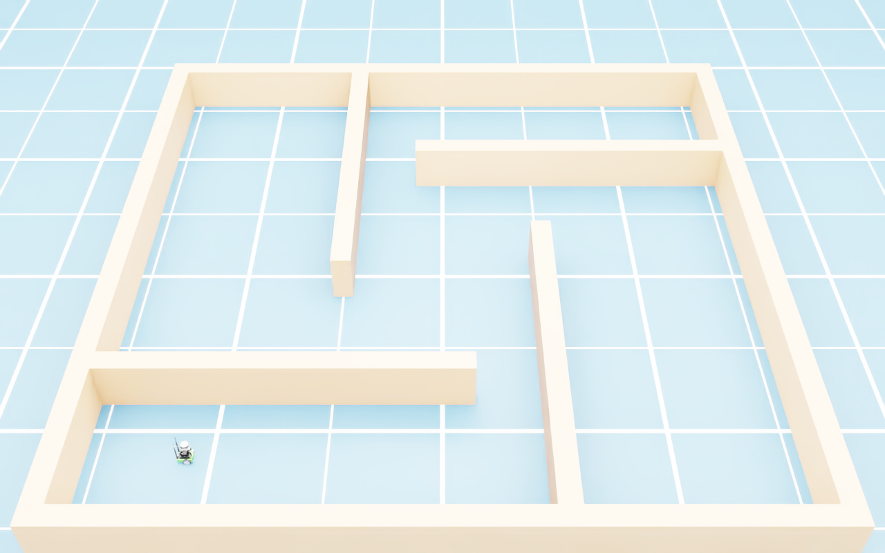
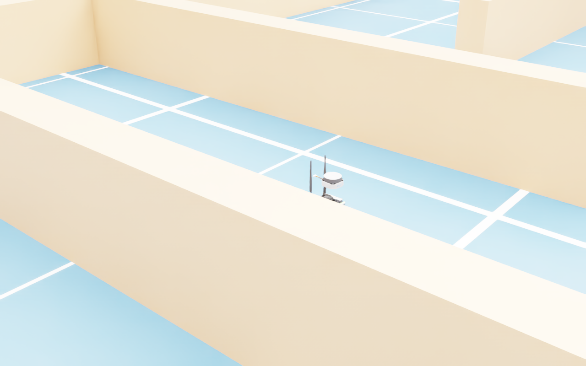
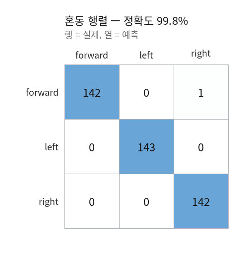
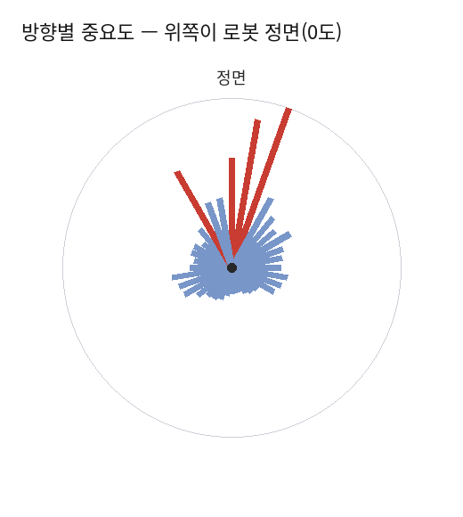
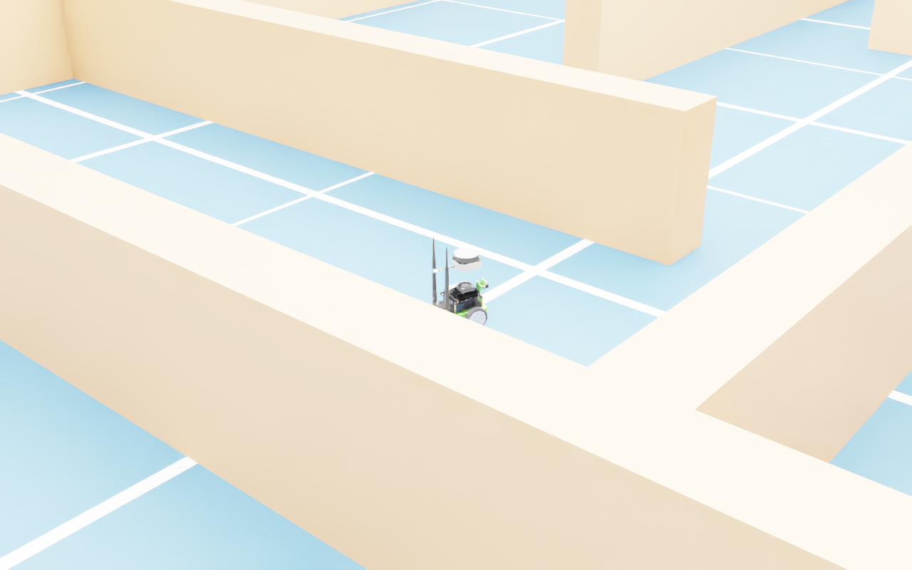

# 22.6 LiDAR 데이터로 주행 분류기 학습하기

> **이 절의 목표**: 시뮬레이터에서 데이터를 모아 → 밖에서 모델을 학습하고 → 다시 시뮬레이터에 넣어 돌려 보는 **한 바퀴**를 완성하는 것.
> 앞 절들이 다룬 강화학습과 달리, 여기서는 **지도학습 분류기**를 쓴다. 바퀴 로봇의 단순 주행에는 이쪽이 훨씬 빠르고 다루기 쉽다.

이 절의 모든 수치는 Isaac Sim 6.1 · RTX 5090 환경에서 실제로 실행해 얻은 값이다.

---

## 22.6.1 왜 강화학습이 아닌가

| | 강화학습 (앞 절들) | **지도학습 분류기 (이 절)** |
|---|---|---|
| 필요한 것 | 보상 설계, 수천 개 병렬 환경 | 주행 기록 몇 천 줄 |
| 학습 시간 | 수십 분~수 시간 | **1초 미만** |
| 설명 가능성 | 정책 내부를 보기 어렵다 | 어느 방향이 중요한지 바로 나온다 |
| 성능 한계 | 사람보다 잘할 수 있다 | **가르친 것 이상은 못 한다** |

벽을 피해 복도를 따라가는 정도는 "사람보다 잘할" 필요가 없다. 이럴 때는 분류기가 맞다.

전체 흐름은 세 단계다.

```
1단계  Isaac Sim    미로 주행 → (LiDAR 거리벡터, 주행판단) CSV 기록
2단계  파이썬       CSV → RandomForest 학습 → joblib 저장
3단계  Isaac Sim    joblib 로드 → 분류기가 직접 로봇 조종
```

---

## 22.6.2 씬 구성 — JetBot과 상자 미로

JetBot은 NVIDIA가 제공하는 소형 2륜 로봇으로, 입문용으로 가장 다루기 쉽다.

```python
JETBOT = "/Isaac/Robots/NVIDIA/Jetbot/jetbot.usd"   # 'Jetbot' — B는 소문자
stage_utils.add_reference_to_stage(usd_path=root + JETBOT, prim_path="/World/Jetbot")
jetbot = world.scene.add(Robot(prim_path="/World/Jetbot", name="jetbot"))
```

JetBot의 관절은 둘뿐이다.

```
['left_wheel_joint', 'right_wheel_joint']
```

### 함정 1 — 속도 제어에는 강성 0, 감쇠 큰 값

> ⚠️ 에셋 기본 게인 그대로 `joint_velocities` 를 주면 **바퀴가 전혀 돌지 않는다.** 위치 제어용 게인이 속도 명령을 눌러 버리기 때문이다.

```python
n = len(jetbot.dof_names)
jetbot.get_articulation_controller().set_gains(
    kps=np.zeros(n),            # 강성 0
    kds=np.ones(n) * 600.0,     # 감쇠는 충분히 크게
)
```

### 함정 2 — 장애물에 충돌체가 없으면 LiDAR가 통과한다

벽을 `VisualCuboid` 로 만들면 눈에는 보이지만 LiDAR 광선이 그냥 지나간다. `FixedCuboid` 를 쓰거나 Rigid Body with Colliders 프리셋을 적용해야 한다.

```python
FixedCuboid(prim_path=f"/World/Maze/Wall_{i}", name=f"wall_{i}",
            position=np.array([cx, cy, 0.25]),
            scale=np.array([sx, sy, 0.5]),
            color=np.array([0.80, 0.42, 0.20]))
```


*[그림 22.6-1] 상자 미로와 JetBot — 통로 폭 1.6 m, 벽은 FixedCuboid(충돌체 포함)*

---

## 22.6.3 LiDAR 선택 — 이 절에서 가장 중요한 결정

예제에서 흔히 쓰는 `Example_Rotary` 는 **차량용 장거리 LiDAR** 다. 소형 실내 로봇에 달면 아무것도 보이지 않는다.

실측한 최소 측정 거리는 다음과 같다.

| config | 최소 거리 | 용도 |
|---|---|---|
| `Example_Rotary` | **1.45 m** | 차량·실외 |
| `Example_Rotary_2D` | **1.45 m** | 차량·실외 |
| **`Slamtec_RPLIDAR_S2E`** | **0.40 m** | **실내 소형 로봇** |
| `SICK_nanoScan3` | 0.40 m | 안전 스캐너 |

> ⚠️ 통로 폭이 1.6 m인 미로에서 최소 거리 1.45 m짜리 센서를 쓰면, 벽이 가까워지는 순간 **반환이 사라진다.** 그런데 "반환 없음"을 "멀리 있음"으로 처리하면 로봇은 벽이 없다고 믿고 그대로 들이받는다. 실제로 이 설정으로 돌렸을 때 로봇은 벽에 붙은 채 영원히 전진 명령만 냈다.

```python
lidar = Lidar.create("/World/Jetbot/chassis/Lidar",
                     config="Slamtec_RPLIDAR_S2E",
                     translations=[[0.0, 0.0, 0.16]])
lidar_sensor = LidarSensor(lidar, annotators=["generic-model-output"])
```

사용 가능한 20종 전체 목록은 다음으로 확인한다.

```python
from isaacsim.sensors.experimental.rtx import SUPPORTED_LIDAR_CONFIGS
print(sorted(SUPPORTED_LIDAR_CONFIGS))
```

---

## 22.6.4 LiDAR 출력 읽기 — 구면좌표다

> ⚠️ **`x`, `y`, `z` 를 평면 좌표로 착각하기 쉽다.** `Example_Rotary` 계열의 GMO 출력은 직교좌표가 아니라 **구면좌표**다.

```python
gmo = parse_generic_model_output_data(data)
print(gmo.elementsCoordsType)    # → CoordsType.SPHERICAL
```

| 필드 | 실제 의미 | 실측 범위 |
|---|---|---|
| `gmo.x` | **방위각(도)** | −180 ~ +180 |
| `gmo.y` | **고도각(도)** | −15 ~ +10 (설정별 수직 FOV) |
| `gmo.z` | **거리(m)** | 센서 최소~최대 |

검증 방법은 간단하다. 로봇 정면 1.9 m에 벽을 하나 두고 정면·수평 방향 점들의 `z` 중앙값을 보면 **정확히 1.900** 이 나온다.

```python
def scan():
    data, _ = lidar_sensor.get_data("generic-model-output")
    if data is None:
        return None
    gmo = parse_generic_model_output_data(data)

    az   = np.asarray(gmo.x, float)    # 방위각(도)
    el   = np.asarray(gmo.y, float)    # 고도각(도)
    dist = np.asarray(gmo.z, float)    # 거리(m)

    # 수평에 가까운 링만 — 바닥·천장 반사를 걸러낸다
    ok = np.isfinite(dist) & (dist > 0.05) & (np.abs(el) < 3.0)
    az, dist = az[ok], dist[ok]
    if az.size == 0:
        return None

    # 한 바퀴를 36칸(10도)으로 요약. 각 칸은 '가장 가까운 것'
    idx = (np.mod(az, 360.0) / (360.0 / N_BINS)).astype(int) % N_BINS
    out = np.full(N_BINS, MAX_RANGE, dtype=np.float32)
    np.minimum.at(out, idx, np.clip(dist, 0.0, MAX_RANGE))
    return out
```

### 함정 3 — RTX 센서는 `render=True` 로만 갱신된다

> ⚠️ `world.step(render=False)` 로 루프를 돌리면 **첫 프레임 값이 그대로 고정된다.** 로봇은 처음 본 장면을 계속 보며 제자리를 맴돈다. 카메라와 같은 함정이다.

```python
world.step(render=True)      # LiDAR·카메라를 쓰는 루프에서는 필수
```

---

## 22.6.5 1단계 — 데이터 수집

라벨을 만드는 주체가 필요하다. 영상 사례처럼 사람이 키보드로 몰아도 되지만, 책에서는 누가 돌려도 같은 결과가 나오도록 **규칙 기반 주행기**를 썼다.

```python
TURN_AT = 0.95      # LiDAR 최소 거리(0.40 m)보다 넉넉히 크게 잡는다

def sectors(bins):
    n = len(bins)
    front = np.concatenate([bins[: n // 12], bins[-(n // 12):]]).min()
    left  = bins[n // 12: n // 3].min()
    right = bins[-(n // 3): -(n // 12)].min()
    return front, left, right

def rule_driver(bins, stuck=False):
    front, left, right = sectors(bins)
    if front > TURN_AT and not stuck:
        return "forward"
    return "left" if left > right else "right"
```

📌 **방위각 0도가 로봇 정면이다.** 로봇 정면 1.5 m에 벽 하나만 두고 칸별 거리를 찍어 보면 0도 부근만 값이 작게 나온다. 센서를 바꾸면 이 보정을 다시 해야 한다.

### 함정 4 — 벽에 끼면 센서만으로는 못 빠져나온다

벽에 밀착하면 거리가 최소 측정 거리 아래로 들어가 반환이 사라진다. 위치가 멈춰 있는지 감시해 강제로 회전시키는 안전장치가 필요하다.

```python
if step % 40 == 0:
    now = np.asarray(jetbot.get_world_pose()[0]).ravel()[:2]
    stall = stall + 1 if np.linalg.norm(now - last_pos) < 0.03 else 0
    last_pos = now.copy()
    stuck = stall >= 2
```

### 실행 결과

```
JetBot 관절: ['left_wheel_joint', 'right_wheel_joint']
수집 2600행 · 최종 위치 [-0.69 -2.45]
라벨 분포: {'forward': 1385, 'right': 645, 'left': 570}
저장: lidar_maze.csv
```

CSV 한 줄은 `d00 ~ d35` 36개 거리값과 라벨 하나다.


*[그림 22.6-2] 규칙 주행기가 데이터를 모으는 중 — 벽을 피해 통로를 따라간다*

---

## 22.6.6 2단계 — 분류기 학습

Isaac Sim이 필요 없다. CSV만 있으면 된다.

### 클래스 균형이 먼저다

> ⚠️ `forward` 가 `left`·`right` 를 합친 것보다 많다. 이대로 학습하면 **"무조건 forward"** 라고만 답해도 정확도 53%가 나온다. 반드시 균형을 맞추자.

```python
counts = Counter(y)
k = min(counts.values())            # 가장 적은 클래스에 맞춘다
keep = np.concatenate([rng.choice(np.where(y == c)[0], k, replace=False) for c in counts])
```

### 학습

```python
clf = RandomForestClassifier(n_estimators=200, max_depth=12, random_state=0, n_jobs=-1)
clf.fit(Xtr, ytr)
```

### 실행 결과

```
1) 불러오기   2600행 × 36칸
   라벨 분포  {'forward': 1385, 'right': 645, 'left': 570}
2) 균형 맞춤  클래스당 570행 → 총 1710행
3) 분할       학습 1282 / 평가 428
4) 학습       RandomForest(200그루, 깊이 12)
   정확도     99.8%

   혼동 행렬 (행=실제, 열=예측)
                forward     left    right
     forward        142        0        1
        left          0      143        0
       right          0        0      142
```


*[그림 22.6-3] 혼동 행렬 — 428개 평가 표본 중 1개만 오분류*

### 99.8%를 믿으면 안 되는 이유

> 📌 **라벨의 품질이 정확도의 상한을 정한다.**
>
> 이 실험의 라벨은 **결정적 규칙**이 만들었다. 같은 입력에는 항상 같은 라벨이 붙는다. 분류기는 그 규칙을 거의 완벽히 복원하면 되므로 99.8%가 나오는 것이 당연하다.
>
> 사람이 키보드로 몰아 라벨을 만들면 이야기가 다르다. 같은 상황에서 어떤 때는 좌회전, 어떤 때는 직진을 누른다. 이런 라벨로 학습하면 **60~70%대**가 현실적인 수치다. 영상 사례의 66%가 그 예다.
>
> 즉 99.8%는 "모델이 좋다"가 아니라 **"가르친 규칙이 단순하다"** 는 뜻이다.

### 어느 방향이 중요한가

RandomForest는 어떤 입력이 판단을 좌우했는지 알려 준다.

```
5) 판단에 가장 중요한 방향 (0도 = 로봇 정면)
    20도  중요도 0.115
    10도  중요도 0.100
   330도  중요도 0.069
     0도  중요도 0.068
    30도  중요도 0.046
   350도  중요도 0.038
```

상위 6개가 전부 **정면 ±30도** 안에 모여 있다. 분류기가 "앞이 막혔는지"를 중심으로 판단한다는 뜻이고, 이는 우리가 설계한 규칙과 정확히 일치한다. 모델이 엉뚱한 것을 배우지 않았다는 확인이다.


*[그림 22.6-4] 방향별 중요도 — 붉은 선이 정면 ±30도에 모여 있다*

> 💡 만약 중요도가 뒤쪽(180도 부근)에 몰린다면 데이터 수집이나 좌표 해석이 잘못된 것이다.

```python
dump({"model": clf, "n_bins": N_BINS, "labels": labels}, "lidar_policy.joblib")
```

---

## 22.6.7 3단계 — 분류기를 시뮬레이터로 되돌리기

씬은 1단계와 똑같다. **판단 주체만 바뀐다.**

```python
bundle = load("lidar_policy.joblib")
clf, labels = bundle["model"], bundle["labels"]
assert bundle["n_bins"] == N_BINS, "학습 때와 칸 수가 다르다"

for step in range(STEPS):
    b = scan()
    if b is None:
        world.step(render=True)
        continue
    lab = str(clf.predict(b.reshape(1, -1))[0])   # 분류기가 결정
    drive(lab)
    world.step(render=True)
```

### 실행 결과

```
분류기 로드: RandomForestClassifier, 라벨 ['forward', 'left', 'right']
판단 분포   {'forward': 1472, 'right': 606, 'left': 520}
규칙과 일치 2544/2598 (97.9%)
이동 경로   13.8 m · 최종 위치 [0.01 -2.39]
```

같은 상황에서 원래 규칙이 내렸을 판단과 **97.9%** 일치했고, 로봇은 벽에 끼지 않고 13.8 m를 주행했다. 학습 정확도(99.8%)보다 조금 낮은데, 이는 분류기가 만든 궤적이 규칙이 만든 궤적과 미세하게 달라져 **학습 때 보지 못한 상황**에 들어가기 때문이다.


*[그림 22.6-5] 분류기가 조종하는 JetBot — 규칙 없이 LiDAR만 보고 주행한다*

> 📌 이것이 모방학습의 고질적 문제인 **분포 이동(distribution shift)** 이다. 모델의 작은 실수가 학습 데이터에 없던 상태로 로봇을 데려가고, 거기서는 예측이 더 나빠진다. Chapter 16.6의 DAgger 계열 기법이 이 문제를 다룬다.

---

## 22.6.8 실습 — 전체 한 바퀴 돌리기

> 🛠️ **실습**: 세 스크립트를 순서대로 실행해 수집 → 학습 → 주행을 완성한다.

```bash
conda activate isaac_env
export OMNI_KIT_ACCEPT_EULA=YES
export OUT_DIR=./out

python lidar_maze_collect.py        # 1단계 — CSV 생성
python lidar_classifier_train.py    # 2단계 — joblib 생성 (Isaac Sim 불필요)
python lidar_classifier_drive.py    # 3단계 — 분류기로 주행
```

**체크리스트**

- [ ] 라벨 세 종류가 모두 모였는가? (한 종류만 나오면 센서나 좌표 해석을 의심한다)
- [ ] 균형 맞춤 후 클래스당 행 수가 같은가?
- [ ] 중요도 상위 방향이 정면(±30도)에 모여 있는가?
- [ ] 3단계에서 로봇이 벽에 끼지 않고 계속 움직이는가?
- [ ] 규칙과의 일치율이 90% 이상인가?

### 더 해 볼 것

1. **`N_BINS` 를 36 → 12 로 줄여 보자.** 정확도가 얼마나 떨어지는가? 실제 로봇에서는 입력 차원이 곧 연산량이다.
2. **벽 배치를 바꾸고 다시 주행시켜 보자.** 학습 때 보지 못한 미로에서도 동작하는가?
3. **`RandomForestClassifier` 를 `DecisionTreeClassifier(max_depth=5)` 로 바꿔 보자.** 트리를 출력하면 규칙을 사람이 읽을 수 있다.

---

## 이 절에서 배운 것

| 항목 | 핵심 |
|---|---|
| 전체 흐름 | 시뮬 수집 → 외부 학습 → 시뮬 재투입 |
| LiDAR 선택 | `Example_Rotary` 는 최소 1.45 m — 실내 로봇엔 `Slamtec_RPLIDAR_S2E`(0.40 m) |
| 좌표 해석 | GMO는 **구면좌표** — x=방위각(도), y=고도각(도), z=거리(m) |
| 센서 갱신 | RTX 센서는 `world.step(render=True)` 로만 갱신된다 |
| 속도 제어 | 바퀴는 강성 0 · 감쇠 큰 값이어야 돈다 |
| 충돌체 | 장애물에 충돌체가 없으면 LiDAR가 통과한다 |
| 반환 없음 | "멀다"가 아니라 "너무 가깝다"일 수 있다 — 끼임 감지가 필요하다 |
| 클래스 균형 | 맞추지 않으면 "무조건 forward"로도 53%가 나온다 |
| 정확도 해석 | 라벨 품질이 상한을 정한다. 규칙 라벨 99.8% vs 사람 라벨 60~70% |
| 분포 이동 | 학습 99.8% → 실주행 97.9%로 떨어지는 이유 |

다음 Chapter에서는 이렇게 만든 모델을 확장 기능으로 감싸 Isaac Sim 안에 통합하는 방법을 다룬다.
